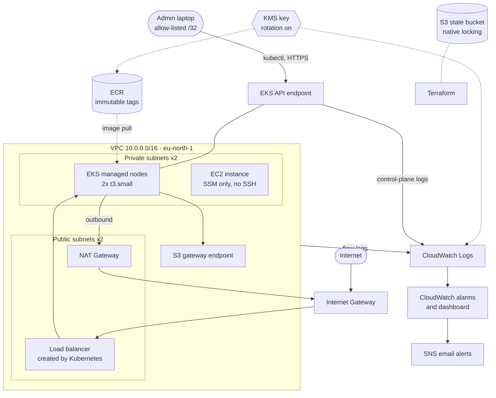
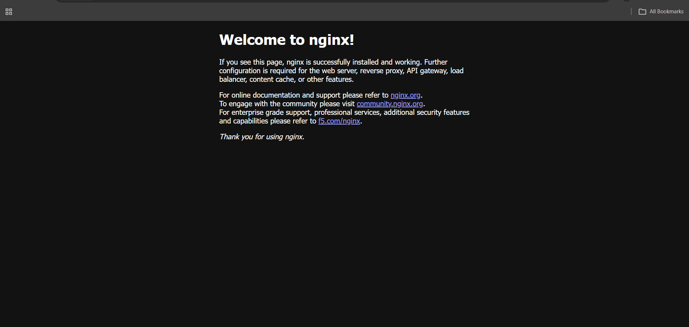

# AWS EKS Terraform Platform

A small, security-minded AWS platform built entirely with Terraform: a private-subnet VPC, an EKS cluster, an ECR repository, encrypted logging, and CloudWatch monitoring with alerting. It was deployed, exercised (including a deliberate failure drill), and torn down with `terraform destroy` to keep costs near zero.

**Region:** eu-north-1 | **Terraform:** >= 1.10 | **AWS provider:** ~> 6.0 | **Kubernetes:** 1.36

## What it builds

| Area | Resources |
|------|-----------|
| Networking | VPC, 2 public + 2 private subnets across 2 AZs, Internet Gateway, single NAT Gateway (toggle), route tables, S3 gateway endpoint |
| Compute | EKS cluster with a managed node group (2x `t3.small`, AL2023), add-ons: vpc-cni, coredns, kube-proxy, eks-pod-identity-agent |
| Registry | ECR repo with immutable tags, scan-on-push, KMS encryption, lifecycle policy (keep last 10 images) |
| Access | SSM-managed EC2 instance in a private subnet: no inbound rules, no SSH keys, IMDSv2 required, encrypted gp3 root volume |
| Security | Customer-managed KMS key (rotation on) for logs and ECR, least-privilege IAM roles, EKS API endpoint restricted to one admin CIDR |
| Observability | VPC flow logs (KMS-encrypted) to CloudWatch, REJECT-traffic metric filter, CloudWatch alarms, SNS email alerts, dashboard, EKS control-plane logs (api, audit, authenticator) |
| State | S3 remote backend with native locking (`use_lockfile = true`, no DynamoDB needed) |
| CI | GitHub Actions: `terraform fmt -check`, `init`, `validate`, and Checkov security scan |

## Architecture


## Repository layout

```
bootstrap/            # creates the S3 state bucket (local state, applied once)
modules/
  vpc/                # VPC, subnets, routing, NAT toggle, flow logs
  ssm_instance/       # private EC2 reachable only via SSM Session Manager
environments/
  dev/                # root config: kms, eks, ecr, monitoring, backend
.github/workflows/    # terraform-ci.yml
```

## How to run it

Prerequisites: Terraform >= 1.10, AWS CLI configured, kubectl.

```bash
# 1. One-time: create the remote state bucket
cd bootstrap
terraform init && terraform apply

# 2. Put the bucket name in environments/dev/backend.tf, then create terraform.tfvars
#    (gitignored) with your own values:
#      admin_cidr  = "x.x.x.x/32"      # your public IP, /32 is required
#      alert_email = "you@example.com"

# 3. Deploy
cd ../environments/dev
terraform init
terraform plan -out=tfplan
terraform apply tfplan

# 4. Connect to the cluster
aws eks update-kubeconfig --name dev-eks --region eu-north-1
kubectl get nodes
```

### Teardown (order matters)

Load balancers created by Kubernetes are not tracked by Terraform and will block VPC deletion.

```bash
kubectl delete svc --all
kubectl delete deployment --all
# wait ~2 minutes, confirm no load balancers remain
terraform destroy
```

After destroy I verified with the AWS CLI that no NAT gateways, Elastic IPs, EBS volumes, EKS clusters or log groups remained.

## Verified results

- Cluster came up with 2 `Ready` nodes spread across both AZs (v1.36.x).
- Deployed nginx behind a `LoadBalancer` service and loaded the welcome page from the internet.
- Terraform CI passes on GitHub Actions.
- `terraform destroy` removed all 76 resources cleanly.

## Incidents and what I learned

**1. Invalid admin CIDR (EKS apply failed).** I set the API endpoint allow-list to a bare IP. EKS requires CIDR notation, so it must be `x.x.x.x/32`. *Fix:* corrected the value. *Prevention:* add a variable validation using `can(cidrhost(var.admin_cidr, 0))` so `terraform plan` catches it early.

**2. Node group stuck in CREATING.** No ASG or instances appeared. The account is on the AWS Free Plan, which restricts EC2 instance types; `t3.medium` was not allowed. *Detection:* `aws eks describe-nodegroup`, `aws ec2 describe-instances`, and the Auto Scaling group showed nothing was launching. I listed allowed types with `aws ec2 describe-instance-types --filters Name=free-tier-eligible,Values=true`. *Fix:* switched to `t3.small`; Terraform replaced the node group. *Prevention:* check account-level limits before choosing instance types.

**3. AccessDenied on `iam:CreateOpenIDConnectProvider`.** An AWS Organizations SCP explicitly denies creating OIDC providers, which overrides any IAM permission. *Fix:* set `enable_irsa = false` and rely on EKS Pod Identity (the `eks-pod-identity-agent` add-on), which does not need an OIDC provider. *Lesson:* IAM allow is not enough; SCPs are a separate guardrail layer.

**4. Failure drill: ImagePullBackOff (deliberate).**
- *Symptom:* after `kubectl set image deployment/web nginx=nginx:does-not-exist`, the new pod stayed in `ErrImagePull`, then `ImagePullBackOff`. The rollout never completed.
- *Detection:* `kubectl get pods`, then `kubectl describe pod <name>`. The Events section showed `docker.io/library/nginx:does-not-exist: not found`.
- *Impact:* none for users. The rolling update kept the two old pods serving traffic while the new pod never became Ready.
- *Fix:* `kubectl rollout undo deployment/web`.
- *Prevention:* pin image tags that exist, use immutable tags (as the ECR repo does), gate deploys on `kubectl rollout status --timeout`, and alert on pods that are not Ready for N minutes.

## Design trade-offs (honest list)

| Choice | Why | Production alternative |
|--------|-----|------------------------|
| Single NAT Gateway | Cost | One NAT per AZ for AZ-failure resilience |
| EKS public endpoint limited to my /32 | Simple access from a laptop | Private-only endpoint behind VPN/bastion/SSM |
| IRSA disabled | SCP blocks OIDC provider creation | IRSA where allowed; Pod Identity is the fallback used here |
| SNS topic not encrypted | Kept the alerting path simple | Encrypt with KMS (needs SNS/CloudWatch key policy) |
| `t3.small` nodes, 2 desired | Free Plan limits and cost | Larger/right-sized nodes, autoscaling policies |
| Single `dev` environment | Time-boxed build | Parameterise names and add `prod` with separate state key |
| Checkov runs with `soft_fail` | Visibility without blocking while iterating | Fail the pipeline on high severity findings |

## Not done (future work)

- AWS WAF in front of the load balancer, AWS Network Firewall, and Ansible configuration management are not implemented. I understand the concepts but have not built them here.
- A `prod` environment and a backup/DR runbook.

## Health check script

`scripts/health_check.py` uses boto3 to check that the EKS cluster and node groups are ACTIVE and that no CloudWatch alarms are firing. It exits non-zero on failure, so it can run from CI or a scheduled job.

    pip install boto3
    python scripts/health_check.py --cluster dev-eks --region eu-north-1
    
## Cost note

The stack was created for a short test session and destroyed afterwards. The only long-lived resource is the S3 state bucket created by `bootstrap/`. Never commit `terraform.tfvars`, `*.tfstate` or plan files (they are in `.gitignore`).
